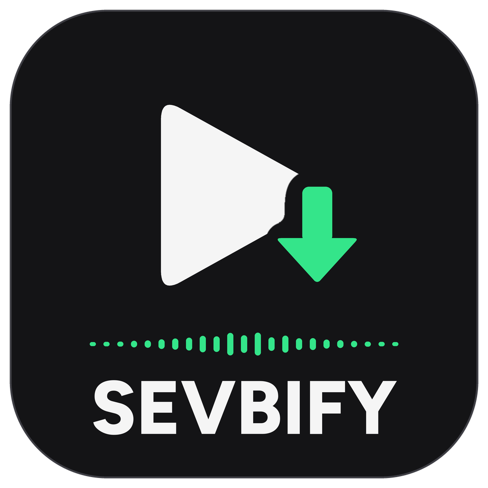

# Sevbify — Local Music Player

Sevbify is an ad-free desktop music player for your own music files, with a familiar dark,
streaming-app-style interface. Built with Python, PyQt6 and VLC.
Windows is the first target platform. It can also download songs you don't have yet, using the
download engine from its sister app SEVBY (see *Downloading songs* below).

Sevbify is built with AI help (Anthropic's Claude writes and tests most of the code; the owner
decides what it does and tests it on Windows).

**Current version:** v4.9.3 — library, search, saved playlists, volume. See `CHANGELOG.md`.

## Requirements

| What | Version | Notes |
|---|---|---|
| Operating system | Windows 10/11 (64-bit), macOS, or Linux | Windows first; macOS and Linux builds are set up and will be switched on later |
| Python | 3.10 – 3.13, **64-bit** | https://www.python.org/downloads/ — tick "Add python.exe to PATH" |
| VLC media player | 3.0.x, **64-bit** | **Only when running from source.** The ready-made Windows app has VLC's engine (libVLC) built in. From source: https://www.videolan.org/vlc/ (must match Python's 64-bit) |
| Python packages | see `requirements.txt` | PyQt6, python-vlc, mutagen, Pillow, certifi, yt-dlp, pytest |
| ffmpeg | nothing to install | Needed for downloading songs. Comes with the `imageio-ffmpeg` package (copied once into `%APPDATA%\Sevbify\ffmpeg` when running from source); the ready-made app has it built in. |

## Quick start (recommended)

**One-time setup**
1. Install **64-bit Python 3.12** (https://www.python.org/downloads/, tick *Add python.exe to PATH*)
   and **64-bit VLC** (https://www.videolan.org/vlc/).
2. In GitHub Desktop: **File → Clone repository → Sevbify**.
3. Optional: copy your music into the clone's `audio` folder (it stays on your PC and is never
   uploaded), or skip this and use **Your Library → Add folder…** in the app.
   With no `audio` folder, the app uses your Windows *Music* folder.

**Every time there's an update**
1. GitHub Desktop → **Fetch origin** → **Pull origin**.
2. Double-click **`Run Sevbify.bat`**.

The first run sets up a private Python environment (about a minute). After that it starts
straight away, and re-installs packages automatically only when an update needs it.
`Run Tests.bat` runs the automated tests.

**Ready-made app (no Python, no GitHub Desktop needed):** open the repo's **Releases** page (right-hand side of the
repo's main page) → newest version → under **Assets** download **Sevbify-Windows.zip** → Extract All → run
**Sevbify.exe**. To open it like any other app, use **Settings → Add to Desktop and Start menu**. It's all in one: VLC's playback engine, the downloader and ffmpeg are inside, so nothing else needs
installing. The install steps are on each release page.

How releases are made: every push is built and tested on a real Windows machine by GitHub Actions (macOS and Linux
builds are set up but switched off until later). When a version is ready, the version number in the `VERSION` file
is changed (e.g. `5.0.0-beta.1`). If every test and check passes, that build is published as a Release tagged
`v5.0.0-beta.1` automatically, with `RELEASE_NOTES.md` as its description. Versions with a dash are marked
*Pre-release*. In-between builds are also downloadable from the **Actions** tab → latest *Build & test*
run → **Sevbify-Windows** (kept for 30 days).
- **macOS:** the app isn't signed by Apple yet, so the first time, right-click `Sevbify.app` → **Open** → **Open**.
- **Linux:** extract with `tar xzf Sevbify-Linux.tar.gz`, then run `Sevbify/Sevbify`. Install VLC with your package manager (e.g. `sudo apt install vlc`).

## Manual setup (Windows, PowerShell)

Open PowerShell **in the project folder** (in File Explorer: Shift + right-click the folder → "Open in Terminal"), then:

```powershell
py -3 -m venv .venv
.\.venv\Scripts\Activate.ps1
python -m pip install --upgrade pip
pip install -r requirements.txt
```

If PowerShell refuses to run `Activate.ps1`, run this once and then try again:

```powershell
Set-ExecutionPolicy -Scope CurrentUser RemoteSigned
```

## Running the app

```powershell
.\.venv\Scripts\Activate.ps1      # if not already active
python app.py
```

You can also launch it from any folder, e.g. `python "C:\path\to\Sevbify\app.py"` —
music and artwork are found relative to the project folder.

## Using the app

| Where | What you can do |
|---|---|
| **Home** | Chips **All / Music / Podcasts / Audiobooks**. Click a cover to play. Right-click for *Add to playlist*. |
| **Search** | Type to search your songs and the web. With the box empty (or the ▦ button in the search bar) it shows **Browse all**: Podcasts, Audiobooks and music genres (popular songs right now). |
| **Your Library** (left) | Chips **Playlists / Podcasts / Audiobooks / Albums / Artists / Downloaded / To download**; 🔍 to filter; **Recents ▾** to sort (Recents, Recently added, Alphabetical) and view (Compact, List, Grid); folders; click *Your Library* to shrink it to covers, ⤢ to fill the window. **+ Create** → Playlist, Folder, or **Import a playlist**. |
| **Your Songs** | Every song in your music folders. Click a column header to sort. **Add folder…** / **✕** / **Rescan**. |
| **Playlists** | Click to open, double-click to play. Change the cover from the playlist page. |
| **Import a playlist** | Paste a public **Spotify** or **Apple Music** playlist/album link, or choose a file (Exportify **CSV**, **TXT** in any language/encoding, **M3U**). Same order and cover; songs already in your music folders play from your files, the rest stream and wait under To download. Your Spotify account is never signed in to. **More than 100 songs:** Spotify only shares 100 per link without signing in, so in Spotify click a song in the playlist, press **Ctrl+A** then **Ctrl+C**, and paste into the second box. |
| **Podcasts** | Search Apple's podcast directory, follow shows, stream or download episodes, continue where you left off. Paste a **YouTube channel** link for video podcasts: **Watch** the video or play the audio only. |
| **Audiobooks** | Free public-domain audiobooks read by LibriVox volunteers (via the Internet Archive): stream chapters, download whole books, carry on where you stopped. |
| **Settings** (⚙ or Ctrl+P) | Online & privacy, music folders on/off, downloads, playback (equaliser, normalise, fade, autoplay), display, Canvas, zoom, start-up and tray, storage, proxy, updates. |
| **A playlist** | ▶ Play, **Preview** (the little cover: flick through the songs one at a time), shuffle, download (green when every song is downloaded), **•••** (Edit details, Delete, Move to folder, Add to other playlist, Share and export). 🔍 searches inside it, **Custom order ▾** sorts the view. **Shift+click** selects a range of songs, **Ctrl+click** adds one; right-click acts on all selected; **Delete** removes them. |
| **Share and export** | **Export playlist file (.m3u8)** writes a list of your music files (it doesn't contain the music). **Copy songs to a folder or phone** copies the actual files, in order ("01 - Artist - Title.mp3") with a playlist file, skipping ones already there. |
| **Player bar** | Play/pause, previous (restarts the song if > 3 s in), next, seek, volume and mute, **Miniplayer** and **Full screen** (F11). |
| **Zoom** | **Ctrl +**, **Ctrl −**, **Ctrl 0** (or View → Zoom, or Settings). Sevbify restarts to show the new size. **Settings → Reset** puts settings back (your music, playlists and downloads are kept). |
| **Private session** | File → Private Session: nothing you play is remembered (Recently played, Recents, podcast positions) until you close Sevbify or 6 hours pass. |
| **Online / Offline** | Click **● Online** at the top right to go offline: Sevbify then contacts nothing at all. |
| **Songs you don't have yet** | Greyed out with **⬇** everywhere (web search results, playlists, To download). While online they **stream in full**; right-click → **Download** to keep them for offline. |
| **Radio** | In the queue panel, **Save as playlist** keeps a Radio as a playlist; songs you don't have stay in their place as ⬇ slots. |
| **To download** (left panel) | Every song waiting to be downloaded: all ⬇ slots in your playlists plus songs you chose *Save for later* on, with **⬇ Download all**. |
| **⬇ pill in the top bar** | Shows download progress ("⬇ 2 of 5 · Song"). Click it for **Pause after this song / Resume**, **Stop all** (stopped songs can be resumed), and each song with **Cancel** or **Try again**. If the internet or the download drive goes away, downloads wait and try again every minute. |

**Keyboard (same as Spotify):** Space = play/pause · Ctrl+→ / Ctrl+← = next / previous · Shift+→ / Shift+← = seek 5 s ·
Ctrl+↑ / Ctrl+↓ = volume · Ctrl+S = shuffle · Ctrl+R = repeat · Ctrl+L = search · Ctrl+F = filter Your Library ·
Ctrl+N = new playlist · Ctrl+P = settings · Ctrl+Shift+R = rescan · F1 = about. All are also in the **•••** menu (top left).

## Adding music

Either put `.mp3`, `.wav`, `.flac`, `.ogg` or `.m4a` files in the bundled `audio` folder and
press **Rescan**, or use **Your Library → Add folder…** to add any folder on your PC.
Artwork comes from (in order): an image in `assets` with the same name as the audio file,
art embedded in the file's tags, or a placeholder.

## Streaming and downloading songs you don't have yet

Songs you find with **Search** or **Radio** can be played and added to playlists before you have them. They sit in
their place greyed out with ⬇, and the playlist header says how many still need downloading to play offline.
Each one is also listed under **To download** on the left.

**While online they stream in full:** when one plays, Sevbify finds the full song (Bandcamp first, then
YouTube, using the song's real length to pick the right recording) and plays it straight away without saving it;
the player shows *Full song · YouTube · not downloaded*. If no full version is found it plays Deezer's 30-second
preview instead. **Settings → Play full songs you don't have yet** switches this off (previews only).
Offline, these songs can't play until they're downloaded.

Right-click such a song → **Download**, use **⬇ Download** on a playlist, or **⬇ Download all** on the
**To download** page. Sevbify then, in the background while your music keeps playing:

1. looks for the song on **Bandcamp** first, then **YouTube** (Settings → Downloads lets you pick
   *Bandcamp + YouTube*, *Bandcamp only* or *YouTube only*);
2. saves it as a tagged **MP3** with cover art in a **`Sevbify downloads`** folder inside your first
   music folder;
3. puts it in the exact place (#) of every playlist it was added to, even if more songs were added after it.

If a download fails, the row says *Download failed*; right-click → **Retry download**, or click the red
⬇ pill at the top. Closing Sevbify stops the current download; finished songs are kept.

The download engine (`core/sevby_engine.py`) is copied from the SEVBY app
(https://github.com/Obamna1234/sevby, MIT) with its window code removed; Sevbify doesn't need SEVBY
installed. To update it after SEVBY changes, run
`python tools/make_engine.py <path to sevby_app.py> core/sevby_engine.py`. Don't edit it by hand.

**Only download music you have the right to download**, for example songs you've bought or that the
artist offers for free. Streaming or downloading YouTube audio outside YouTube's own player (which also skips
its ads) goes against YouTube's terms of service; Sevbify shows this notice once, before the first full stream or
download, and you decide. Sevbify never downloads from file-sharing
networks, torrents or "ripping groups": those mostly share music without the artists' permission.
Sevbify is not affiliated with YouTube, Bandcamp, Apple, Spotify, Deezer, or **Sevby LLC (sevby.com)**.

**What is tested:** the download queue, stopping, failures, retry, the one-time notice, slots filling
in their exact place, and Radio → playlist → Download all are covered by automated tests that use a
*fake* downloader (no internet). The real Bandcamp/YouTube download is checked on GitHub's Windows
machine on every push (reports only: cloud servers are often blocked by YouTube), but it **has not yet
been tried from inside Sevbify on a home PC**. The same engine works in SEVBY on Windows.

## Where your playlists and settings are saved

`%APPDATA%\Sevbify\library.json` (paste that into File Explorer's address bar). Playlists saved
under the app's earlier names (`%APPDATA%\Aurvo` or `%APPDATA%\Custom Spotify Replica`) are copied across automatically on first launch.
Playlists, volume and music folders are saved automatically. Songs inside the project folder are
saved with relative paths, so moving the project folder doesn't break playlists. If a song's
file goes missing, it stays in the playlist greyed out as "(file missing)" instead of being
removed. If the save file is ever damaged, the app keeps a copy (`library.corrupt-<date>.json`)
and starts fresh rather than crashing. Delete `library.json` to reset to first-run state.

## Running the automated tests

```powershell
python -m pytest tests -v
```

The tests generate short WAV tones and play them through VLC's silent dummy output in a
hidden window, so they make no sound and don't touch your music. They need VLC installed.

## Privacy

No account, no ads, no tracking, nothing sold. With online features on, Sevbify contacts only what each feature
needs: Deezer (search, radio, genres, previews), Wikipedia (artist info), DuckDuckGo (only a finished search whose results look wrong, for “Did you mean”), Apple iTunes (song names, the podcast
directory), the podcasts' own feeds, the Internet Archive (audiobooks), Bandcamp and YouTube (full songs, downloads,
video podcasts), Spotify / Apple Music only when you import a playlist link, LRCLIB (lyrics: the song's name and
length; can be switched off), song.link (only when you share a song) and GitHub (update checks; can be switched
off). Those sites see your IP address and what you look up, like a web browser would. Sevbify only looks
at the music folders you add; it never searches the rest of your computer. Settings → Online features off: nothing
is contacted at all.

## Project layout

| Path | Purpose |
|---|---|
| `Run Sevbify.bat` | One-click launcher (sets up Python packages automatically) |
| `Run Tests.bat` | Runs the automated tests |
| `.github/workflows/build.yml` | Automatic tests + app builds for Windows, macOS and Linux on every push |
| `app.py` | Entry point. Shows a clear message if VLC is missing. `--smoke-test` starts, loads the library and exits (used by the automatic build). |
| `core/` | Data and logic with no UI code: `paths.py`, `models.py` (Song, Playlist), `library.py` (folder scanning), `storage.py` (save file), `downloader.py` (runs songs through the download engine) |
| `core/sevby_engine.py` | SEVBY's download engine, **generated** by `tools/make_engine.py`; never edit by hand |
| `ui/download_manager.py` | Background download queue (one song at a time, in its own thread) |
| `tools/download_check.py` | Live download check run on GitHub (one Creative Commons song) |
| `ui/main_window.py` | Main window: pages, player bar, playback, playlist actions |
| `ui/track_table.py` | Song list used by Search, Your Library and playlist pages |
| `ui/theme.py`, `ui/top_bar.py`, `ui/library_panel.py`, `ui/cards.py` | Spotify-style look: colours/fonts, top bar, Your Library panel, Home cards |
| `core/streamer.py` | Finds a full-length stream for a song you don't have (Bandcamp, then YouTube) |
| `core/importers.py` | Playlist import: Spotify / Apple Music links, CSV, TXT (any encoding), M3U |
| `core/podcasts.py`, `core/audiobooks.py` | Podcast directory + RSS feeds + YouTube channels; LibriVox audiobooks via archive.org |
| `core/library_index.py` | Albums and artists built from your files |
| `core/updates.py` | Update checks for Sevbify and yt-dlp |
| `ui/library_panel.py`, `ui/settings_page.py` | Your Library panel; the Settings page |
| `ui/shows_page.py`, `ui/shows_controller.py`, `ui/video_page.py` | Podcasts, audiobooks, Browse and the video player |
| `tests/` | Automated playback regression tests |
| `audio/` | Your music (optional; kept on your PC only, not uploaded to GitHub) |
| `assets/` | Artwork images + `album_covers/placeholder.png` |
| `album_covers/` | Generated cache (extracted art, playlist collages) — safe to delete; not uploaded |

## Credits and licences

- Sevbify's own code: MIT.
- Download engine: from SEVBY (MIT). Uses **yt-dlp** (Unlicense) and **ffmpeg** (the ready-made app
  bundles an ffmpeg build from the `imageio-ffmpeg` package, which is GPL-licensed; see https://ffmpeg.org).
- Logo and icons: original artwork for Sevbify, drawn by `tools/make_logo.py` (files in `assets/branding`).
- Playback: VLC's engine, libVLC (LGPL 2.1+; some plugins GPL) by VideoLAN, via python-vlc. The ready-made Windows
  app includes libVLC and its plugins in `_internal\vlc`, with VLC's licence as `VLC-COPYING.txt`; VLC's source code
  is at https://www.videolan.org. Font: Figtree (SIL Open Font License).
- Podcasts: Apple's public podcast directory and each show's own RSS feed. Audiobooks: LibriVox recordings (public
  domain) hosted by the Internet Archive.

## Android app

`android/` holds the Android app (Kotlin + Jetpack Compose, Android 13 or newer). It runs this repository's
`core/` Python code through Chaquopy, so the Windows app and the phone app share search, matching, downloads,
importing, podcasts and audiobooks; only the screens differ (modelled on Spotify's phone app). GitHub builds
it on every push (`gradle -p android assembleRelease`) and each release carries `Sevbify-Android.apk`.
Install steps are in the release notes. The release signing key is not in the repository: GitHub's build reads it
from the `ANDROID_KEYSTORE_BASE64` and `ANDROID_KEYSTORE_PASSWORD` secrets (building it yourself without them gives
a debug-signed APK).

## Known limitations

- The library is re-read from the files on every launch (fine for hundreds of songs; a cache will be needed for very large libraries).
- Video podcasts (YouTube) and full songs from YouTube depend on yt-dlp keeping up with YouTube's changes: use
  Settings → Update yt-dlp if they stop working.
- A Spotify playlist link brings in 100 songs; paste the songs copied in Spotify (Ctrl+A, Ctrl+C) to get them all.
- Spotify's own Canvas loops can't be fetched without signing in to a Spotify account, so Sevbify doesn't; add
  your own loop with a song's ••• → Canvas video.
- Zoom needs a restart to apply (Sevbify is drawn at one size when it starts).
- Full streaming of songs you don't have depends on Bandcamp/YouTube being reachable (not in mainland China
  without a VPN, for example) and can break when YouTube changes; then the 30-second preview is used.
