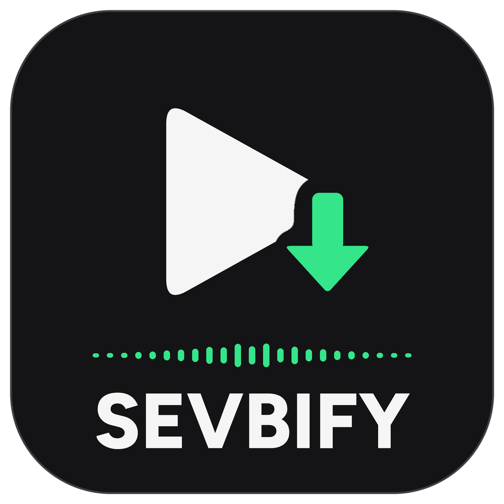

# Sevbify

Sevbify is a free, private music player for **Windows, macOS, Linux, Android and iPhone**. Play your own music,
find songs and podcasts online, make playlists, and take it all with you. No account, no ads, no tracking, nothing
sold.

> **Beta.** Sevbify 5.0 is in public beta. Please report problems on the
> [Issues](https://github.com/Obamna1234/Sevbify/issues) page (please leave out personal details).

**Download:** the [latest release](https://github.com/Obamna1234/Sevbify/releases) has every platform, with install
steps on the release page. Sevbify updates itself after that.

## What it does

- **Your music:** folders on your computer or phone, SD cards, cloud folders through the phone's file picker, or your
  own **Jellyfin / Nextcloud** server.
- **Find music online:** search songs, artists, albums and genres; artist pages, song radio, charts for your country
  and "Made for you" mixes built on your own device from what you play.
- **Play and keep:** songs found online can be played and saved for offline listening, from Bandcamp, SoundCloud,
  YouTube and openly licensed music libraries (Jamendo, the Internet Archive). See *Using online music responsibly*.
- **Playlists:** Liked Songs, folders, drag-and-drop, and import from a playlist link (Spotify, Apple Music, Deezer,
  Jamendo) or a .csv / .txt / .m3u file.
- **Podcasts and audiobooks:** follow shows (video podcasts too) and listen to free public-domain audiobooks from
  LibriVox.
- **Phone and computer together:** pair your phone with your computer by scanning a QR code and send songs and
  folders either way, over your own Wi-Fi only.
- **And:** lyrics, equaliser, crossfade, sleep timer, private sessions, instant zoom, mini player, 20 languages,
  Bluetooth and car support, and automatic updates.

## Using online music responsibly

Sevbify is a player and organiser. It doesn't host or share any music, and it isn't affiliated with Bandcamp,
SoundCloud, YouTube, Deezer, Apple, Spotify or any other service it can work with.

- **Only download music you have the right to download**, for example songs you've bought, that the artist offers
  for free, or that are openly licensed (Creative Commons, public domain).
- Using some sites' music outside their own apps may not be allowed by those sites' terms. Sevbify shows a notice
  about this before the first stream or download, and you decide.
- Sevbify never uses file-sharing networks or torrents, and never signs in to anyone's streaming account.
- Support the artists you listen to: buy their music (Bandcamp makes this easy), go to their shows.

If you're a rights holder with a concern about this project, please open an issue on GitHub.

## Privacy

- **No account, no ads, no tracking, nothing sold.** Your library, playlists and listening history stay on your
  devices. "Made for you" mixes are worked out on your device.
- **Online features only contact what they need:** music catalogues for search (Deezer, Apple), the music sites a
  song plays from, Wikipedia (artist info), LRCLIB (lyrics), podcast feeds, the Internet Archive (audiobooks) and
  GitHub (update checks). Those sites see your IP address and what you look up, as with any website. Requests carry
  only the app's name, nothing about you.
- **Offline mode:** click **● Online** in the top bar (or turn online features off in Settings) and Sevbify contacts
  nothing at all. A proxy/VPN can be set in Settings.
- **Private session:** nothing you play is remembered until you end it or close Sevbify.
- **Pairing a phone** works only on your own network, is encrypted, and needs your OK for every transfer. Nothing goes
  through the internet. See [SECURITY.md](SECURITY.md).

## Install

- **Windows:** download `Sevbify-Windows-Setup.exe` and open it (no admin password needed; uninstall from Settings →
  Apps). Or download `Sevbify-Windows.zip`, extract it and run `Sevbify.exe`.
- **macOS:** download `Sevbify-macOS.dmg`, open it and drag Sevbify onto Applications. The first time, right-click it →
  **Open** → **Open** (the app isn't signed by Apple yet).
- **Linux:** `tar xzf Sevbify-Linux.tar.gz`, then run `Sevbify/Sevbify`. Install VLC with your package manager
  (for example `sudo apt install vlc`).
- **Android:** install `Sevbify-Android.apk` (allow installing from your browser or file manager when asked).
- **iPhone:** install `Sevbify-iOS.ipa` with SideStore or AltStore (steps on the release page); after that, Settings →
  Sevbify updates adds the update source.

The first time you pair a phone, your computer may ask whether Sevbify may use the network (Windows firewall, macOS)
and your iPhone asks about the local network: choose **Allow**.

## Running from source

Needs **64-bit Python 3.10–3.13** and **64-bit VLC 3.0** (the ready-made apps include VLC's engine).

```
python -m venv .venv
.venv\Scripts\activate          (Windows)   |   source .venv/bin/activate   (macOS / Linux)
pip install -r requirements.txt
python app.py
```

On Windows you can also double-click `Run Sevbify.bat`, which sets everything up the first time.

Tests: `python -m pytest tests`. They play generated test tones through VLC's silent output and never touch your
music.

## How releases are made

Every change is built and tested automatically on Windows, macOS, Linux, an Android emulator and an iPhone
simulator. Automated tests and demos use only openly licensed music. When the version number in `VERSION` changes and
everything passes, the build is published as a release, with `RELEASE_NOTES.md` as its description. Each update is
checked against its SHA-256 before it's installed. The Android signing key isn't in this repository.

## Project layout

| Path | What's there |
|---|---|
| `app.py` | Starts the desktop app |
| `core/` | Everything that isn't screens: library, playlists, search, playback helpers, podcasts, downloads, pairing (shared with the phone apps) |
| `ui/` | The desktop app's windows (PyQt6) |
| `android/` | The Android app (Kotlin + Jetpack Compose; runs `core/` through Chaquopy) |
| `ios/` | The iPhone app (SwiftUI; runs `core/` with an embedded Python) |
| `tests/` | Automated tests |
| `tools/` | Build, check and maintenance scripts |

## Credits and licences

- Sevbify's own code: MIT.
- Playback: libVLC by VideoLAN (LGPL 2.1+; some plugins GPL), via python-vlc. The ready-made apps include it, with
  VLC's licence. Source: https://www.videolan.org.
- Downloads use yt-dlp (Unlicense) and ffmpeg (GPL; from the `imageio-ffmpeg` package, see https://ffmpeg.org).
- QR codes: segno (BSD). Encryption: PyCryptodome (BSD / public domain), and the phones' own system libraries.
- Font: Figtree (SIL Open Font License). Logo and icons: original artwork for Sevbify.
- Audiobooks: LibriVox recordings (public domain), hosted by the Internet Archive.

Built with AI help: Anthropic's Claude writes and tests most of the code; the owner decides what it does and tests it.
